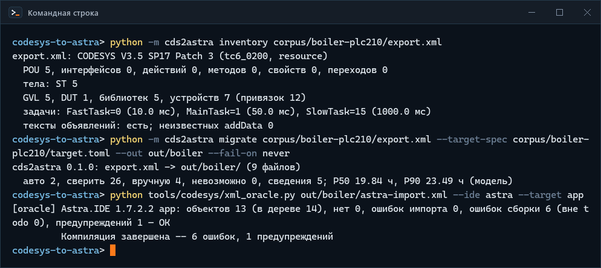
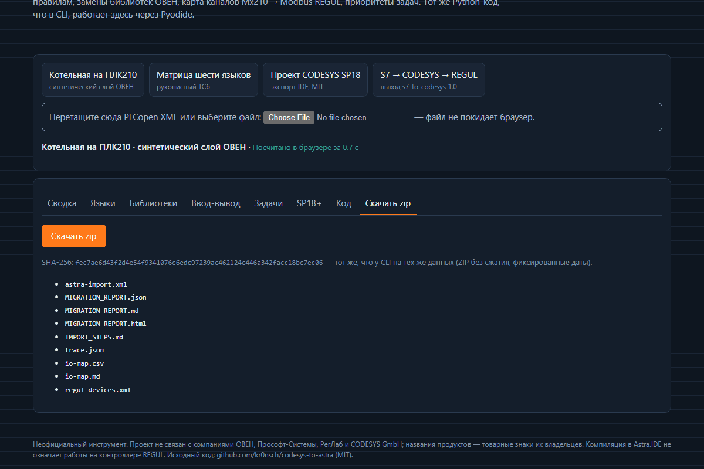
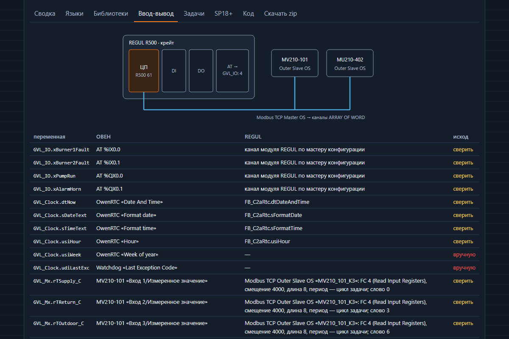
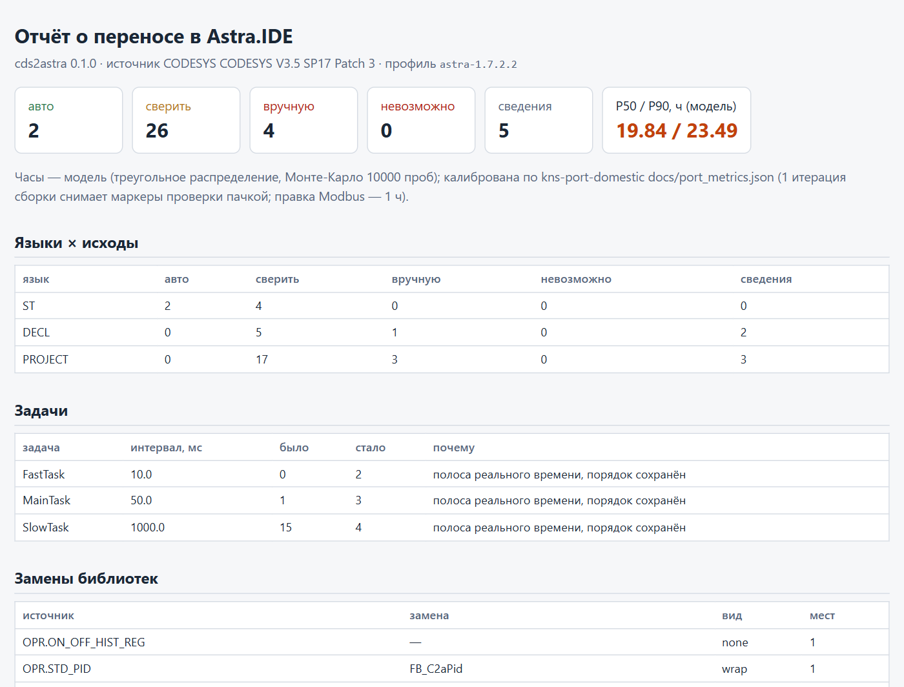
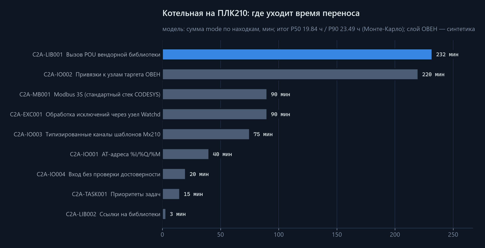
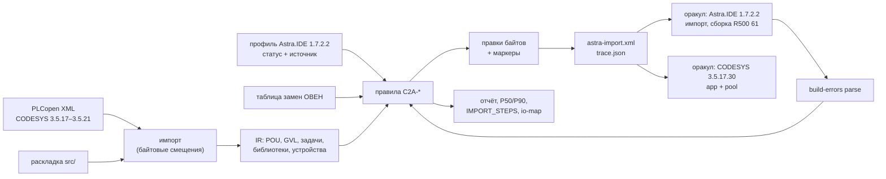

<p align="center">
  <picture>
    <source media="(prefers-color-scheme: dark)" srcset="docs/media/banner-dark.svg">
    <source media="(prefers-color-scheme: light)" srcset="docs/media/banner-light.svg">
    
  </picture>
</p>

<p align="center">
  <a href="https://github.com/kr0nsch/codesys-to-astra/actions/workflows/ci.yml"></a>
  <a href="LICENSE"></a>
  <a href="https://kr0nsch.github.io/codesys-to-astra/"></a>
  
  
  
</p>

<p align="center">
  <a href="#демонстрация">Демо</a> ·
  <a href="#архитектура">Архитектура</a> ·
  <a href="#быстрый-старт">Быстрый старт</a> ·
  <a href="docs/">Документация</a> ·
  <a href="#summary-en">Summary (EN)</a>
</p>

**cds2astra переносит проект CODESYS 3.5 — в первую очередь ОВЕН ПЛК2xx — на контроллеры REGUL в
Astra.IDE 1.7.2.** На вход — PLCopen XML (или ST-раскладка `src/`), на выход — файл импорта Astra.IDE с
заменёнными библиотеками ОВЕН, вводом-выводом на Modbus REGUL и пересчитанными приоритетами задач, плюс
отчёт: что сделано автоматически, что сверить, что переписать руками, и сколько это займёт.

Для кого: интеграторы и службы АСУ ТП, которые переводят объекты с ПЛК ОВЕН (и проекты CODESYS SP18–SP21
других вендоров) на REGUL. Почему этого не делает сама среда: Astra.IDE — OEM CODESYS 3.5.17 и импортирует
PLCopen XML, но импорт не переносит ни задачи, ни ссылки на библиотеки, ни устройства, IL не импортируется
вовсе (пробы P1–P6, [docs/PROBES.md](docs/PROBES.md)), а библиотек ОВЕН, узлов таргета ПЛК210 и шаблонов
Mx210 в Astra.IDE нет. Ручной перенос одного проекта ([kns-port-domestic](https://github.com/kr0nsch/kns-port-domestic))
показал, где именно ломается сборка; cds2astra делает те же шаги повторяемо и проверяет результат настоящей
Astra.IDE 1.7.2.2.

> Проект не связан с компаниями ОВЕН, Прософт-Системы, РегЛаб и CODESYS GmbH; названия продуктов — товарные
> знаки их владельцев. Инструмент неофициальный. «Собирается в Astra.IDE» не значит «работает на
> контроллере REGUL»: на железе выход не запускался.

## Демонстрация

<p align="center">
  
</p>
<p align="center"><sub>Реальная сессия на Astra.IDE 1.7.2.2 (без интерфейса, <code>--noUI --runscript</code>), 20.10.2026; снято term2gif.py. Котельная — синтетический пример</sub></p>

<p align="center">
  
</p>
<p align="center"><sub><a href="https://kr0nsch.github.io/codesys-to-astra/">Живое демо</a>: тот же пакет Python работает в браузере через Pyodide, файл не покидает браузер. Кадры сняты с собранного демо</sub></p>

<table>
<tr>
<td width="50%"></td>
<td width="50%"></td>
</tr>
<tr>
<td><sub>Вкладка «Ввод-вывод» демо (тёмная тема)</sub></td>
<td><sub>MIGRATION_REPORT.html котельной (светлая тема)</sub></td>
</tr>
</table>

<p align="center">
  
</p>
<p align="center"><sub>Минуты по правилам для котельной — модель (сумма наиболее вероятных оценок), не замер; слой ОВЕН — синтетика</sub></p>

## Что переносится и что нет

| Конструкция | Что делает cds2astra | Исход |
|---|---|---|
| ST, DUT, GVL, методы, свойства, интерфейсы | переносит как есть; ООП собирается в Astra.IDE 1.7.2.2 (P8) | авто |
| FBD, LD, CFC, SFC | как есть: импорт и обратный экспорт в обеих IDE проверены (P5) | сведения / сверить (SFC) |
| IL | перевод в ST для подмножества (LD/ST, логика, арифметика, сравнения, JMP, CAL, RET), остальное — вручную | сверить / вручную |
| Вызовы OwenStringUtils | замена на функции AstraCompat (`F_C2a*`) с теми же сигнатурами | авто / сверить |
| `STD_PID` (CmpOwenPidRegs) | обёртка `FB_C2aPid` на Util с теми же пинами | сверить |
| `ON_OFF_HIST_REG` и библиотеки ОВЕН без аналога | маркер `// C2A-…` и пункт отчёта | вручную |
| `AT %I/%Q` | переменные — в `GVL_IO`, обращения переименованы, привязка к модулю REGUL — по `io-map` | сверить |
| Узлы таргета ПЛК210 (OwenRTC, Watchdog …) | OwenRTC → `FB_C2aRtc` на SysTimeRtc; без аналога — вручную | сверить / вручную |
| Модули Mx210 по Modbus TCP | каналы `Modbus TCP Outer Slave OS` (`ARRAY OF WORD`), распаковка с проверкой статуса канала | сверить |
| Приоритеты задач | пересчёт в полосу REGUL 2–13 с сохранением порядка, 0 (только RegulBus) и 15 (визуализация) учтены | сверить |
| Задачи, ссылки на библиотеки, дерево устройств | импорт их не переносит (P3, P6) — таблицы в `IMPORT_STEPS.md`, ЦП — `regul-devices.xml` | вручную (шаги) |
| SP18–SP21: `UTF8#`, частичный доступ к битам, библиотеки новее 3.5.17 | понижение до 3.5.17 там, где это механика; `VAR_GENERIC`, новый LD SP20 — вручную | авто / вручную |
| Визуализация, конфигураторы Modbus/OPC UA, символьная конфигурация | не переносятся (в PLCopen XML их нет) | вручную |

Полный список правил с объяснениями и источниками — [docs/RULES.md](docs/RULES.md), замены библиотек —
[docs/LIBMAP.md](docs/LIBMAP.md), ввод-вывод — [docs/IO.md](docs/IO.md).

## Архитектура



Ядро — только стандартная библиотека Python, поэтому тот же код работает в браузере. Правки делаются
байтами исходного XML: без правил выход побайтно равен входу, а diff результата с входом читается глазами.
Подробно — [docs/ARCHITECTURE.md](docs/ARCHITECTURE.md).

## Быстрый старт

Нужен Python 3.11+; Astra.IDE и CODESYS для этого не нужны.

```bash
git clone https://github.com/kr0nsch/codesys-to-astra && cd codesys-to-astra
python -m pip install -e .
cds2astra inventory corpus/boiler-plc210/export.xml
cds2astra migrate corpus/boiler-plc210/export.xml --target-spec corpus/boiler-plc210/target.toml --out out/boiler --zip out/boiler.zip
```

Ожидаемый вывод `migrate`:

```text
cds2astra 0.1.0: export.xml -> out/boiler/ (9 файлов)
  авто 2, сверить 26, вручную 4, невозможно 0, сведения 5; P50 19.84 ч, P90 23.49 ч (модель)
```

Код выхода 1 — в отчёте есть пункты «вручную» (`--fail-on never` отключает). В `out/boiler/`:
`astra-import.xml`, `MIGRATION_REPORT.html` (откройте в браузере), `IMPORT_STEPS.md`, `io-map.csv`,
`regul-devices.xml`, `trace.json`. Другие примеры: `corpus/lang-matrix/source.handmade.xml` (шесть
языков), `corpus/sp18-speedtests/…xml` (CODESYS SP18, понижение), `corpus/s7-chain` (раскладка ST).

```bash
cds2astra explain C2A-IO003          # что делает правило и откуда данные
cds2astra analyze <файл.xml>         # только отчёт, без записи файлов
cds2astra profiles show astra-1.7.2.2
```

## Как использовать в своём проекте

1. **Экспорт из CODESYS.** «Проект → Экспорт PLCopenXML», всё приложение, с флагом «экспортировать
   объявления как простой текст» (без него часть объявлений восстанавливается с потерями — C2A-FMT001).
2. **Цель.** Файл `target.toml` по образцу `corpus/boiler-plc210/target.toml`: ЦП (`REGUL R500 61` и
   т. п.), тип ЦП, шина, резервирование, синхронизируемая задача.
3. **Перенос.** `cds2astra migrate project.xml --target-spec target.toml --out out/project`.
4. **Разбор отчёта.** `MIGRATION_REPORT.html`: пункты «вручную» и «сверить» с объектом и строкой; в коде
   они же — маркеры `// C2A-…`. Замены библиотек и каналы Modbus — с ссылками на страницы документации.
5. **Импорт в Astra.IDE.** По `IMPORT_STEPS.md`: проект мастером Regul, библиотеки (в том числе
   AstraCompat из релиза), «Импорт PLCopenXML», устройства Modbus по `io-map.md`, задачи по таблице.
6. **Сборка и цикл исправления.** Сообщения сборки — в файл, `cds2astra build-errors parse messages.txt
   --trace out/project/trace.json` покажет объект, правило и что править. Повторить до ошибок только в
   объектах с пунктами «вручную».
7. **Железо.** Порядок слов FLOAT32 Mx210, RETAIN после загрузки, таймауты Modbus —
   [docs/HARDWARE_VALIDATION.md](docs/HARDWARE_VALIDATION.md).

## Два оракула: что проверяют Astra.IDE 1.7.2.2 и CODESYS 3.5.17.30

`tools/codesys/xml_oracle.py` создаёт проект в настоящей IDE скриптом без интерфейса, ставит библиотеки,
импортирует `astra-import.xml`, назначает задачи, собирает и экспортирует обратно. Ошибка допустима только
в объекте, где отчёт уже поставил «вручную» (сверка 1:1 через `trace.json`). Прогон 20.10.2026:

| Случай | Astra.IDE 1.7.2.2 (R500 61 / пул) | CODESYS 3.5.17.30 (Control Win / пул) |
|---|---|---|
| котельная на ПЛК210 (синтетика), 13 объектов | 6 ошибок — все в `PRG_Backup` (`ON_OFF_HIST_REG` без замены) | то же |
| матрица шести языков, 7 объектов | 0 ошибок | 0 ошибок |
| цепочка S7 → CODESYS → REGUL, 40 объектов | 0 ошибок | 0 ошибок |
| проект CODESYS SP18 (MIT), 45 объектов | 0 ошибок (предупреждения: 7 в app, 5 в пуле — из исходника и задачи визуализации без POU) | то же |

Что это доказывает: выход импортируется без потерь объектов и собирается компилятором 3.5.17.30 — тем же,
что в профиле `Astra.IDE_V1.7.2.2`, — с настоящей библиотекой драйвера `PsIoDrvModbusTcpMaster_OS` в
Astra.IDE. Чего не доказывает: что перенесённый код ведёт себя так же, как на ПЛК210, и что он работает на
контроллере REGUL. Таблица по всем 16 прогонам — [docs/TEST_REPORT.md](docs/TEST_REPORT.md), разбор
сообщений — [docs/BUILD_ERRORS.md](docs/BUILD_ERRORS.md).

## Эквивалентность: что она доказывает

В 0.1.0 — ничего: оракул поведения (одинаковые трассы исходника с двойниками ОВЕН и результата с
AstraCompat поцикло) не сделан ([docs/ROADMAP.md](docs/ROADMAP.md)). Поведение проверено только у
AstraCompat: 25 тестов coUnit в CODESYS Control Win проходят. Тесты, двойники и сама AstraCompat написаны по
одной документации ОВЕН, поэтому совпадение с ПЛК210 не доказано — для этого есть раздел 3
[docs/HARDWARE_VALIDATION.md](docs/HARDWARE_VALIDATION.md).

## Цепочка S7 → REGUL (ST)

Выход [s7-to-codesys](https://github.com/kr0nsch/s7-to-codesys) 1.0 (ST-раскладка) — обычный вход
cds2astra: `cds2astra migrate corpus/s7-chain --out out/s7-chain`. Маркеры `MIGRATION-CHECK/TODO`
конвертера распознаются и попадают в отчёт (C2A-MARK), `AT %M` остаются (на REGUL есть `%M`), RETAIN
отмечается. Результат — 40 объектов — импортируется и собирается в Astra.IDE 1.7.2.2 и CODESYS 3.5.17.30 без
ошибок.

## Тесты и проверки

| Проверка | Результат (20.10.2026) |
|---|---|
| pytest | 688 тестов; покрытие `cds2astra/`: строки 91.9 %, ветви 81.4 % |
| ruff, mypy `--strict` | чисто |
| корпус правил | 26 правил, случаи pos и neg |
| round-trip `preserve` | 100 % побайтно |
| AstraCompat | сборка 0/0 в обеих IDE, coUnit 25/25 |
| оракулы импорта и сборки | 16 из 16 |
| ложные срабатывания | 0 из 115 находок на niksosov, SRCI, SP18, S7 ([docs/FP_LABELS.md](docs/FP_LABELS.md)) |
| RuSTy, iec_checker, st_lint | без необоснованных находок ([docs/STATIC_ANALYSIS.md](docs/STATIC_ANALYSIS.md)) |
| веб-демо | e2e зелёный, SHA-256 zip в Pyodide равен CPython |

CI (GitHub Actions) гоняет всё, кроме оракулов IDE и coUnit, на ubuntu и windows с Python 3.12 и 3.14 и
сравнивает SHA-256 архивов между ОС.

## Документация

| Вопрос | Документ |
|---|---|
| Как устроено, откуда заимствовано | [ARCHITECTURE.md](docs/ARCHITECTURE.md) |
| Что делает каждое правило | [RULES.md](docs/RULES.md) |
| Чем заменяются библиотеки ОВЕН | [LIBMAP.md](docs/LIBMAP.md) |
| Как переносится ввод-вывод | [IO.md](docs/IO.md) |
| Что проверено пробами в IDE | [PROBES.md](docs/PROBES.md), [FORMAT-NOTES.md](docs/FORMAT-NOTES.md) |
| Числа проверок | [TEST_REPORT.md](docs/TEST_REPORT.md), [FP_LABELS.md](docs/FP_LABELS.md) |
| Сообщения сборки и их разбор | [BUILD_ERRORS.md](docs/BUILD_ERRORS.md) |
| Что принято без проверки | [ASSUMPTIONS.md](docs/ASSUMPTIONS.md) |
| Что проверить на железе и у владельца IDE | [HARDWARE_VALIDATION.md](docs/HARDWARE_VALIDATION.md), [OWNER_EXPERIMENTS.md](docs/OWNER_EXPERIMENTS.md) |
| Источники фактов | [SOURCES.md](docs/SOURCES.md) |
| Сборка AstraCompat, оракулы | [MANUAL_STEPS.md](docs/MANUAL_STEPS.md) |
| Что не вошло | [ROADMAP.md](docs/ROADMAP.md) |

## Чего инструмент не делает

- Не переносит визуализацию, конфигураторы устройств и символьную конфигурацию — их нет в PLCopen XML.
- Не создаёт задачи, ссылки на библиотеки и модули Modbus в проекте Astra.IDE: импорт этого не умеет,
  поэтому это шаги `IMPORT_STEPS.md`.
- Не выдумывает замены: у POU ОВЕН без описания в документации замены нет, это пункт «вручную».
- Не проверяет поведение перенесённого кода и не запускает его на контроллере.
- Не знает порядок слов FLOAT32 Mx210 через драйвер REGUL и `SIZEOF(POINTER)` на R500 — это пункты «сверить»
  до проверки на железе ([docs/ASSUMPTIONS.md](docs/ASSUMPTIONS.md)).
- Котельная в примерах вымышленная, слой ОВЕН в ней синтетический: таргеты ОВЕН в CODESYS не ставились.

## Summary (EN)

cds2astra ports CODESYS 3.5 projects — primarily OWEN PLC2xx (SP17), with SP18–SP21 downgraded — to REGUL
controllers in Astra.IDE 1.7.2. It reads PLCopen XML (or an ST source layout), applies 26 platform rules
(OWEN library replacements via the AstraCompat ST library, I/O moved to REGUL Modbus TCP channels, task
priorities remapped to the REGUL band, IL rewritten to ST, SP18+ constructs lowered), and writes an
Astra.IDE import file with a byte-level trace, a migration report with P50/P90 effort (model), import steps,
an I/O map and a REGUL CPU device fragment. Edits are byte splices: with no rules the output is byte-identical.
Verified locally on 2026-10-20 by importing and building the output in Astra.IDE 1.7.2.2 (REGUL R500 61) and
CODESYS 3.5.17.30 (app and POU pool): 16 of 16 oracle runs pass, errors only in objects already flagged for
manual work; AstraCompat passes 25/25 coUnit tests. Not run on REGUL hardware; behavioural equivalence is not
checked in 0.1.0. A browser demo runs the same Python package via Pyodide. Docs are in Russian.

## Лицензия

[MIT](LICENSE) © 2026 kr0nsch. Образцы в `corpus/sp18-speedtests` и `corpus/srci` — MIT их авторов (LICENSE
рядом).

---

<p align="center"><b>Портфолио АСУ ТП</b> · <sub>инструменты и практики для ПЛК ОВЕН и REGUL</sub></p>
<table>
<tr><td width="33%"><a href="https://github.com/kr0nsch/plc-repo-template">01 · plc-repo-template</a><br><sub>ST в git, сборка для ПЛК210 и R500, CI</sub></td><td width="33%"><a href="https://github.com/kr0nsch/plc-process-lib">02 · plc-process-lib</a><br><sub>ФБ: AI, двигатель, ПЧ, задвижка, ПИД, тревоги</sub></td><td width="33%"><a href="https://github.com/kr0nsch/kns-pump-station">03 · kns-pump-station</a><br><sub>флагман: КНС, ПМИ на модели, сборка ПЛК210</sub></td></tr>
<tr><td width="33%"><a href="https://github.com/kr0nsch/kns-port-domestic">04 · kns-port-domestic</a><br><sub>перенос КНС на REGUL R500 (Astra.IDE)</sub></td><td width="33%"><a href="https://github.com/kr0nsch/plc-iiot-stack">05 · plc-iiot-stack</a><br><sub>OPC UA / MQTT → InfluxDB → Grafana</sub></td><td width="33%"><a href="https://github.com/kr0nsch/iolistgen">06 · iolistgen</a><br><sub>перечень сигналов → ST, карты Modbus, SCADA</sub></td></tr>
<tr><td width="33%"><a href="https://github.com/kr0nsch/plc-ci-toolkit">07 · plc-ci-toolkit</a><br><sub>линтеры, сборка CODESYS, тесты, JUnit</sub></td><td width="33%"><a href="https://github.com/kr0nsch/s7-to-codesys">08 · s7-to-codesys</a><br><sub>конвертер SCL → ST с отчётом о переносе</sub></td><td width="33%"><a href="https://github.com/kr0nsch/sis-interlock-demo">09 · sis-interlock-demo</a><br><sub>ПАЗ: MooN, матрица причин и следствий</sub></td></tr>
</table>

<p align="center"><b>Миграция ПЛК-проектов</b></p>
<table>
<tr><td width="33%"><span data-repo="codesys-to-s7">01 · codesys-to-s7</span> <sub>(готовится)</sub><br><sub>CODESYS → Siemens S7: SCL, SimaticML, round-trip</sub></td><td width="33%"><a href="https://github.com/kr0nsch/codesys-to-astra"><b>02 · codesys-to-astra</b></a><br><sub>CODESYS → REGUL/Astra.IDE: библиотеки, ввод-вывод</sub></td><td width="33%"><span data-repo="codesys-to-polygon">03 · codesys-to-polygon</span> <sub>(готовится)</sub><br><sub>CODESYS → «Полигон»: анализ и перенос в FBD</sub></td></tr>
<tr><td width="33%"><span data-repo="codesys-to-masterscada">04 · codesys-to-masterscada</span> <sub>(готовится)</sub><br><sub>CODESYS → MasterSCADA 4D: логика и объекты</sub></td><td width="33%"><span data-repo="codesys-to-forgelogic">05 · codesys-to-forgelogic</span> <sub>(готовится)</sub><br><sub>CODESYS → МЭК 61499: ФБ, события, 4diac</sub></td></tr>
</table>
<p align="center"><sub>Обратное направление — <a href="https://github.com/kr0nsch/s7-to-codesys">s7-to-codesys</a> (Siemens S7 → CODESYS); перенос в ALTA IDE — <span data-repo="alta-port">alta-port</span> <sub>(готовится)</sub>.</sub></p>
