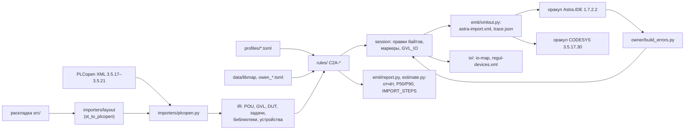

# Архитектура cds2astra

Инструмент читает PLCopen XML проекта CODESYS 3.5 (или ST-раскладку `src/` в стиле plc-repo-template),
строит промежуточное представление, прогоняет правила платформы REGUL и пишет файл импорта Astra.IDE
1.7.2.2 с отчётом. Ядро — только стандартная библиотека Python 3.12: тот же код работает в CLI и в
браузере (Pyodide, веб-демо).

## Слои

| Каталог | Что делает |
|---|---|
| `cds2astra/xmltree.py` | разбор XML на expat с байтовыми смещениями каждого элемента; DOCTYPE и сущности отклоняются (XXE, «миллиард смехов») |
| `cds2astra/importers/plcopen.py` | три размещения (`types`, `resource`, `application`), POU/действия/переходы/методы/свойства/интерфейсы, GVL, DUT, задачи с `TaskSettings`, библиотеки, дерево устройств и привязки, ловушка CFC |
| `cds2astra/importers/layout/` | копия конвертера раскладки kns-port-domestic (см. «Заимствования») |
| `cds2astra/ir/` | модель (`model.py`) и лексер ST без потерь (`st.py`): токены с позициями, правки текста, разбор блоков VAR |
| `cds2astra/profiles/`, `profiles.py` | профили цели и источника: у каждого значения статус (`documented`, `observed_in_sample`, `verified_local`, `owner_verified`, `unknown`), источник и дата |
| `cds2astra/rules/` | правила C2A-* (`registry.py` — справочник, `st_rules.py`, `project_rules.py`, `lang_rules.py`) |
| `cds2astra/libmap.py`, `data/libmap/` | таблица замен библиотек ОВЕН: `map`, `wrap`, `stub`, `none` со ссылкой на страницу документа |
| `cds2astra/session.py` | правки как вставки и замены байтов исходного XML; маркеры `// C2A-…` над оператором; конфликт правок — находка C2A-EDIT |
| `cds2astra/emit/` | `xmlout.py` (формы `preserve` и `astra`), `report.py` (JSON по схеме семейства, MD, HTML), `steps.py` (`IMPORT_STEPS.md`) |
| `cds2astra/io/` | карта каналов (`io-map.csv/.md`) и фрагмент дерева устройств REGUL (`regul-devices.xml`) |
| `cds2astra/estimate.py` | модель трудоёмкости: треугольные распределения по правилам, Монте-Карло 10 000 прогонов, свой LCG (одинаково в CPython и Pyodide) |
| `cds2astra/owner/` | разбор сообщений сборки (`build-errors`) и пакет проб для владельца (`probe`) |
| `cds2astra/api.py`, `cli.py` | функции для веба и CLI: `inventory`, `analyze`, `migrate`, `downgrade`, `explain`, `profiles`, `probe`, `build-errors` |
| `src/`, `tests/` | библиотека ST AstraCompat (префикс `C2a`) и её тесты coUnit |
| `stubs/ps/` | заглушка типа `ChannelStatus` драйвера `PsIoDrvModbusTcpMaster_OS` — только для сборки в CODESYS |
| `tools/codesys/` | сборка и тесты ST (`cds.py`), оракул импорта (`xml_oracle.py` → `xml_oracle_ide.py` в IronPython IDE) |
| `web/` | Vite + TypeScript + Pyodide: тот же пакет `cds2astra` в Web Worker |

## Решения

**Правки байтами, а не пересборкой дерева.** Выход в форме `preserve` без единой правки побайтно равен
входу (тест на всём корпусе). Правка — замена диапазона байтов с известными смещениями; текст ST
внутри `xhtml` правится через карту «символ → байт» с экранированием. Так не теряются чужие `addData`,
порядок атрибутов, переводы строк и комментарии, а diff результата с входом читается глазами.

**Форма `pous` по умолчанию.** Пробы P1/P2 показали, что ни Astra.IDE 1.7.2.2, ни CODESYS 3.5.17.30 не
импортируют размещение `resource` (instances/configuration) без устройства с тем же именем; `types/pous`
импортируется и в приложение, и в пул POU. Задачи и библиотеки переносятся шагами `IMPORT_STEPS.md`
(P3, P6), устройства — отдельным `regul-devices.xml` (E6).

**Ссылки на библиотеки не пишутся в XML.** Импорт `addData` с библиотеками в Astra.IDE падает
(«Не удалось создать объект 'Менеджер библиотек' … DefaultResolution отсутствует», BUILD_ERRORS 1.1),
а там, где не падает, ссылки не создаются (P3). Список библиотек цели — в отчёте и `IMPORT_STEPS.md`.

**Новых объектов в выходе два: `GVL_IO` и `PRG_C2aIoUpdate`.** Они строятся тем же
конвертером раскладки, что и вход из `src/`, с UUID5 от имени проекта — повторный перенос даёт те же
байты (идемпотентность: `migrate(migrate(x)) == migrate(x)`).

**Профиль вместо констант в коде.** Приоритеты задач, лимиты памяти, флаги ООП и импорта, тип статуса
канала Modbus — значения профиля со статусом и источником. Правило с `unknown` в профиле не делает
правку, а ставит `check`.

**Оракулы — настоящие IDE.** `xml_oracle.py` создаёт проект в Astra.IDE 1.7.2.2 (устройство REGUL R500
61, devdesc 11.7.2.60) или CODESYS 3.5.17.30 (Control Win V3 или пул POU), ставит библиотеки, импортирует
`astra-import.xml`, назначает задачи, собирает и экспортирует обратно. Ошибки допускаются только в
объектах с находкой `todo` (1:1 через `trace.json`). Блокировки — протокол `FileLock` `cds.py`; у
Astra.IDE свой репозиторий библиотек и свой файл блокировки `astra-library-repo.lock`.

## Заимствования

| Что | Откуда | Коммит | Лицензия |
|---|---|---|---|
| `cds2astra/importers/layout/st_to_plcopen.py` (конвертер раскладки ST → TC6, без загрузки XSD и CLI) | `kns-port-domestic/tools/st_to_plcopen.py` | `6262d0fdc065ceb9d891c1ac3ab150010dc75ef1` | MIT, тот же автор |
| образец скрипта оракула (импорт в IDE, сборка, обратный экспорт) — переписан в `tools/codesys/xml_oracle_ide.py` | `kns-port-domestic/tools/plcopen/cds_import_check.py` | `6262d0fdc065ceb9d891c1ac3ab150010dc75ef1` | MIT, тот же автор |
| `tools/` (`cds.py`, `assemble.py`, `st_flavors.py`, `check/`, тесты) | `s7-to-codesys` | `2285760` | MIT, тот же автор |
| `corpus/s7-chain/src/` — выход s7-to-codesys 1.0 | `s7-to-codesys` | `2285760` | MIT, тот же автор |
| фикстура ООП `constructs` (только для пробы P8, в репозиторий не кладётся) | `kns-port-domestic/tools/plcopen/tests/fixtures/constructs` | `6262d0f` | MIT, тот же автор |

Изменения копий описаны в их шапках; `cds2astra/importers/layout/stlayout.py` и
`tools/codesys/stlayout.py` должны совпадать побайтно — это проверяет тест.

## Самопроверка AstraCompat

`PRG_C2aSelfTest` — программа, которую `cds.py` ставит в задачу при сборке библиотеки как приложения:
она вызывает каждую функцию AstraCompat, чтобы компилятор проверил все тела (неиспользуемые POU в
приложении не компилируются). Тесты поведения — в `tests/` (coUnit).
